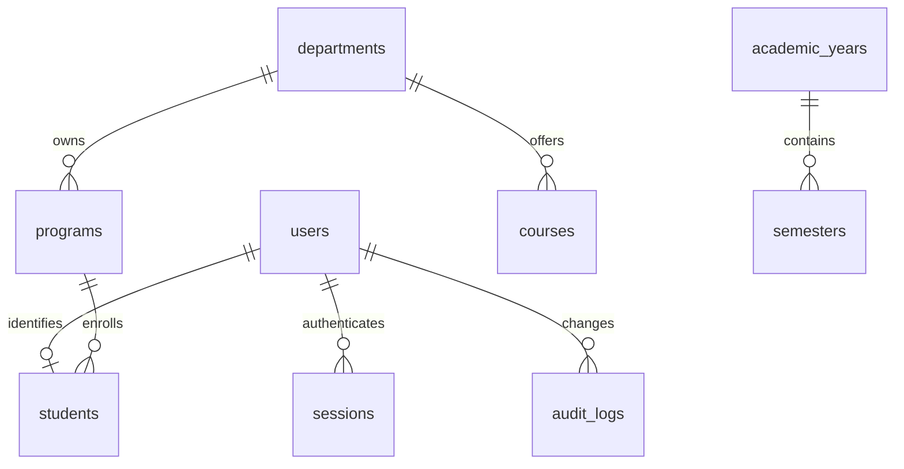

# Database relationships

The SQL migration contains field definitions and keys. Academic codes, email addresses and student numbers are unique. Audit records carry resource type and record ID. schema_migrations records the checksum of each applied migration. Archiving keeps academic identifiers stable for future enrollment records.

## Academic operations

A program and batch identify a student cohort. An offering links a course, term, teacher and program. Registrations link students to offerings. Attendance, marks and grade publication refer to the registration. Invoices link to students and receipts link to invoices. Library loans link students and books. Timetable rows link offerings to a room and slot. Each thesis belongs to a student and has an assigned supervisor and a private submission/feedback history. The complete keys and constraints are in db/002_operations.sql and db/003_teaching_finance.sql.

Migrations 004–006 contain grade snapshots and thresholds, sessions and assessments, invoice/receipt details, physical copies, fines, notice publication, feedback/vivas, notifications, availability, policies, permissions and histories. The current financial totals and account role remain compatible with the original schema. BLUEPRINT_CHECKLIST.md describes the historical-data conversions.
